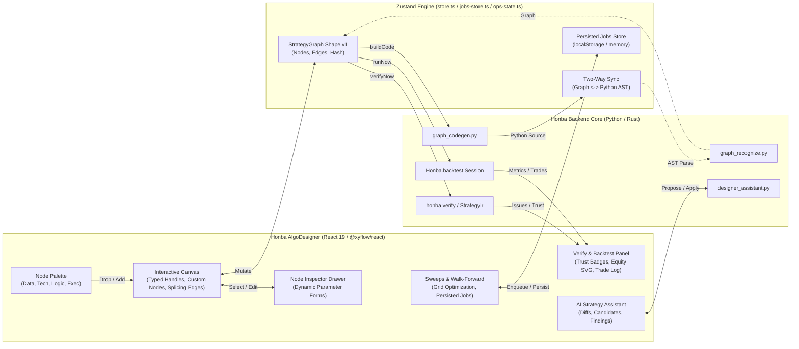

# Honba Algo Designer: Implementation Plan

Date: 2026-10-16  
Status: **Proposed**  
Reference: [ADR 0029 (honba/docs/adr/0029-strategy-graph-and-algodesigner.md)](file:///home/pmallapp/Devel/Finance/honba-labs/honba/docs/adr/0029-strategy-graph-and-algodesigner.md)  
Survey: [OpenAlgo Algo Designer Survey](file:///home/pmallapp/Devel/Finance/honba-labs/honba-frontend/docs/OpenAlgo-AlgoDesigner-Survey.md)

---

## 1. Context & Objectives

The Honba Algo Designer (`honba-frontend/src/apps/algodesigner-app.tsx`) enables quantitative researchers and traders to visually design algorithmic trading strategies, generate reproducible Python strategy classes, verify them against the Rust `StrategyIr` engine, run event-driven backtests, and manage live execution.

While the backend architecture is established in **ADR 0029** (`honba.strategies.graph`, `graph_codegen`, `graph_recognize`, `designer`), the current frontend canvas in `honba-frontend/src/apps/algodesigner/canvas.tsx` is an early prototype with static grid positioning, disabled edge wiring, no node palette, and a single generic card component.

This plan details how to implement a state-of-the-art visual strategy composer in Honba, incorporating the UX capabilities observed in OpenAlgo's Flow designer while respecting Honba's institutional requirements:
1. **Strictly Typed Port Handles**: Connection validation enforcing compatibility between `bars`, `series`, `bool`, `size`, and `order`.
2. **Deterministic Dual Representation**: Lossless visual graph $\longleftrightarrow$ byte-deterministic Python `Strategy` module via `graph_codegen` and `graph_recognize`.
3. **Institutional Verification & Trust Badges**: Real-time canvas defect markers and validation badges (Deflated Sharpe Ratio, Probability of Backtest Overfitting, Holdout tests, Walk-Forward).
4. **Interactive Graph Manipulation**: Drag-and-drop palette, click-to-add, custom midpoint splicing edges (`InsertableEdge`), parameter inspector drawer, and keyboard shortcuts.

---

## 2. Architecture & Design Principles

### Key Principles
* **Zero Engine Duplication**: The UI never evaluates strategy logic or performs calculations locally; it coordinates with Honba's existing Python services and Rust crates.
* **Derived Catalogue**: Node definitions and indicator parameters are introspected directly from `catalogue()` (mirrored from `honba.strategies.indicators`), never hardcoded.
* **Port Compatibility Enforcement**: React Flow connection attempts between mismatched ports (`series` to `order`) are rejected immediately with visual feedback.
* **Safe Mutation & Revision Tracking**: Canvas edits are tracked with an `isModified` dirty guard and cheap hash revision comparisons, ensuring Run and Verify actions execute the exact visual graph on screen.

---

## 3. Detailed Component Architecture

### 3.1 Node Classification & Port Specifications

Honba's graph defines 10 core node types (`honba-frontend/src/core/graph/validation.ts`):

| Node Type | Category | Inputs (Ports: Kind) | Outputs (Ports: Kind) | Parameters |
| :--- | :--- | :--- | :--- | :--- |
| `universe` | Data Root | None | `bars`: `series` | `symbol`, `exchange`, `interval`, `aggregation` |
| `benchmark` | Data | `input`: `series` | `value`: `series` | `symbol`, `exchange` |
| `indicator` | Technical | `input`: `series` | `value`: `series` (or multi-port) | `kind` (SMA, EMA, RSI, MACD, etc.), dynamic params |
| `transform` | Technical | `input`: `series` | `value`: `series` | `op` (log, scale, diff, pct_change) |
| `condition` | Logic | `left`: `series`, `right`: `series` | `signal`: `bool` | `op` (`crosses_above`, `crosses_below`, `>`, `<`, `==`), `threshold` |
| `logic` | Logic | `a`: `bool`, `b`: `bool` | `signal`: `bool` | `op` (`and`, `or`, `not`) |
| `schedule` | Logic | None | `signal`: `bool` | `cron`, `market_phase` (open, close, intraday) |
| `risk` | Execution | `signal`: `bool` | `signal`: `bool` | `max_drawdown`, `max_leverage`, `daily_stop` |
| `sizing` | Execution | `signal`: `bool` | `size`: `size` | `method` (`fixed`, `percent_equity`, `volatility`), `value` |
| `order` | Execution | `signal`: `bool`, `size`: `size` | `orders`: `order` | `side` (`buy`, `sell`), `quantity`, `reason` |

### 3.2 Visual Port Handles & Connection Rules
Port handles will be placed intentionally:
* **Target Handles (Inputs)**: Positioned on the **Top** or **Left** of the node card.
* **Source Handles (Outputs)**: Positioned on the **Bottom** or **Right** of the node card.
* **Handle Color Standards**:
  * `series`: Cyan (`var(--accent-series, #38bdf8)`)
  * `bool`: Amber / Green (`var(--accent-bool, #eab308)`)
  * `size`: Violet (`var(--accent-size, #a855f7)`)
  * `order`: Emerald / Red (`var(--accent-order, #22c55e)`)

---

## 4. Phased Implementation Roadmap

### Phase 1: Interactive Canvas Engine & Store Modernization [Completed]
* **1.1 Store State Updates (`core/designer/store.ts`)**:
  * Stored node positions in `positions: Record<string, { x: number; y: number }>`.
  * Selection tracking (`selectedNodeId`, `selectedEdgeId`), dirty tracking (`isModified`), and snapshot revision hashing.
* **1.2 Canvas Viewport (`apps/algodesigner/canvas.tsx`)**:
  * Freeform drag-and-drop, zoom, pan, and $16\text{px}$ snap-to-grid.
  * Keyboard shortcuts (`Delete`, `Backspace`, `Ctrl+S`, `Esc`).

---

### Phase 2: Categorized Node Palette & Custom Honba Nodes [Completed]
* **2.1 Node Palette (`apps/algodesigner/palette.tsx`)**:
  * Categories: Data Root, Indicators (introspected from `catalogue()`), Transforms & Rules, Execution.
  * Drag start and click-to-add insertion.
* **2.2 Base Honba Node (`apps/algodesigner/nodes/BaseHonbaNode.tsx`)**:
  * Category border accents, parameter chips, verification defect badges, and color-coded port handles.
* **2.3 Specialized Node Cards (`apps/algodesigner/nodes/HonbaNodes.tsx`)**:
  * 10 custom components including Universe, Indicator, Condition, Order, Sizing, and Risk nodes.

---

### Phase 3: Port-Typed Connections & Midpoint Splicing Edges [Completed]
* **3.1 Interactive Port Validation**:
  * Strict compatibility validation (`series` to `series`, `bool` to `bool`, etc.).
* **3.2 Custom Insertable Edge (`apps/algodesigner/edges/HonbaInsertableEdge.tsx`)**:
  * SVG paths with floating `+` button and context-aware node splicing menu.
  * Atomic `spliceEdge` store action.

---

### Phase 4: Dedicated Node Configuration Inspector [Completed]
* **4.1 Inspector Drawer (`apps/algodesigner/inspector.tsx`)**:
  * Dynamic form fields for Universe, Indicators, Conditions, Orders, Sizing, and Risk.
* **4.2 Continuous Code Sync**:
  * Real-time Python code generation via `buildCode()` on every field change.

---

### Phase 5: Verification, Backtest Diagnostics & Ops Console Integration [Completed]
* **5.1 In-Canvas Verification & Defect Locating**:
  * Toolbar Verify action, defect glow borders, and click-to-focus navigation in canvas.
* **5.2 Backtest Execution & Diagnostic Views**:
  * Toolbar Run backtest action, performance summary cards, and native dual-path SVG Equity & Underwater Drawdown curves.
  * ADR 0029 Trust Badges display (DSR, PBO, Holdout, Walk-Forward) and unmodelled assumptions.
* **5.3 Ops Console (`OpsPanel`)**:
  * Execution mode switcher (`paper`, `signal_only`, `live`), Emergency Kill Switch safety latch, live orders table, and terminal audit log.

---

### Phase 6: JSON Export/Import, Revisions & Automated Testing [Completed]
* **6.1 Portability**:
  * Strategy JSON export (`canonicalJson`) and Replace-from-JSON modal with live schema validation.
* **6.2 Versioning**:
  * Snapshot version manager with SHA-256 hashes, timestamps, and one-click restore.
* **6.3 Automated Test Suite**:
  * Full unit tests in `src/core/designer/canvas.test.ts`.

---

### Phase 7: AI Strategy Assistant & Graph/Code Diff Integration (ADR 0029 S5) [In Progress]
**Goals**: Empower users to ideate, refine, and audit strategies using AI with guaranteed institutional safety constraints (propose-never-execute, verifier routing, typed decisions).

* **7.1 Store & Assistant State Model (`core/designer/store.ts`, `core/designer/assistant-types.ts`)**:
  * Full `AssistantMessage` support: `discussion`, `candidate`, `validation_error`.
  * Candidate proposals carry graph diff (`added_nodes`, `modified_nodes`, `removed_nodes`, `param_changes`), candidate Python source, and AI risk decisions (`approve`, `veto`, `size_down`).
  * Add store action `applyProposal(messageIndex: number)`: creates a safety snapshot, applies candidate graph via `setGraph()`, regenerates code, and notifies user.
  * Add store action `proposeAI(prompt: string, client?: HonbaClient)`: routes through prompt handlers generating structured candidates or advisory discussion.
* **7.2 Interactive Assistant Panel (`apps/algodesigner/panels.tsx`)**:
  * **Discussion Card**: Conversational quantitative advice, parameter hints, indicator synergy explanations.
  * **Candidate Proposal Card**:
    * AI badge with proposal description.
    * Visual graph diff badges highlighting added/modified nodes.
    * Code preview snippet.
    * One-click **"Apply Proposal to Canvas"** button.
    * AI decision badges (`approve`, `veto`, `size_down`).
  * **Validation Error Card**:
    * Displays static check failures or lookahead findings.
    * Explicit "BLOCKED" pill certifying unverified candidates cannot run.
  * **Quick Suggestion Chips**:
    * "Add Trailing Stop & Risk Sizing"
    * "Add Volatility Filter (ATR / Bollinger)"
    * "Switch to RSI Momentum Reversal"
    * "Optimize Fast/Slow Moving Average Periods"

---

### Phase 8: Sweeps, Walk-Forward Grid Optimization & Persisted Jobs Engine (ADR 0029 S7) [In Progress]
**Goals**: Provide quantitative parameter sweeps and rolling walk-forward optimization that execute asynchronously and persist across browser reloads.

* **8.1 Designer Navigation & State**:
  * Add `'sweeps'` to `DesignerTab` in `store.ts` and `TABS` in `algodesigner-app.tsx`.
  * Live status pill showing active/queued job count in navigation.
* **8.2 Parameter Grid Configuration Panel (`apps/algodesigner/sweeps-panel.tsx`)**:
  * Introspect parameters from all active canvas nodes (e.g. `f.period`, `s.period`, `rsi.period`).
  * Range selector: `Min`, `Max`, `Step` or discrete values array.
  * Optimization target selector (`Sharpe Ratio`, `Total Return`, `Min Drawdown`, `Profit Factor`).
  * Walk-Forward Split configuration (In-Sample % vs Out-of-Sample %, rolling fold count).
* **8.3 Persisted Asynchronous Job Engine Integration**:
  * Wire directly to `useJobsStore` (`jobs.ts`, `jobs-store.ts`) with `localStorage` persistence.
  * Async job execution simulation / API invocation (`client.postSweeps`).
  * Queue management: cancel, delete, status tracking (`queued`, `running`, `completed`, `failed`).
* **8.4 Multi-Parameter Results Matrix & Canvas Sync**:
  * Performance results matrix table sorting by target metric.
  * Optimal combination highlight with one-click **"Apply Optimal Parameters to Canvas"** action.
  * Walk-Forward Efficiency (WFE) analysis card showing stability across rolling folds.

---

## 5. Verification Checklist

- [x] Canvas allows free dragging, zooming, panning, and snapping to grid.
- [x] Nodes can be added via drag-and-drop from the palette or by clicking a palette item.
- [x] Every node type renders distinct category colors, icons, and typed port handles.
- [x] Dragging an edge from an incompatible port kind is cleanly rejected.
- [x] Hovering over a connected edge reveals a `+` button that splices compatible nodes.
- [x] Clicking any node opens the right inspector drawer with schema-validated form controls.
- [x] Editing node parameters immediately updates the generated Python code tab.
- [x] Clicking "Verify" marks offending nodes on canvas with error badges and highlights issues.
- [x] Clicking "Run" executes a backtest and displays trust badges, equity curves, and metrics.
- [x] Graph can be exported and imported as lossless JSON without breaking node bindings.
- [ ] AI Assistant generates typed candidates with visual graph diffs and one-click apply to canvas.
- [ ] Blocked candidates with validation errors are visually quarantined from execution.
- [ ] Sweeps panel introspects graph parameters and enqueues async optimization jobs.
- [ ] Jobs persist across browser sessions in localStorage via `useJobsStore`.
- [ ] Optimal sweep parameters can be applied directly back to visual canvas nodes.
