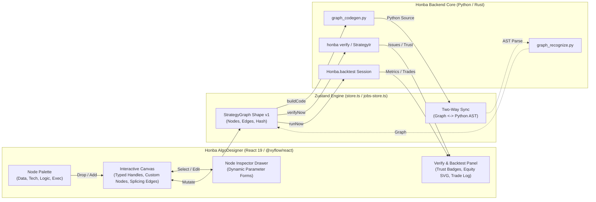

# Honba Algo Designer: Implementation Plan

Date: 2026-10-16  
Status: **Proposed**  
Reference: [ADR 0029 (honba/docs/adr/0029-strategy-graph-and-algodesigner.md)](file:///home/pmallapp/Devel/Finance/honba-labs/honba/docs/adr/0029-strategy-graph-and-algodesigner.md)  
Survey: [OpenAlgo Algo Designer Survey](file:///home/pmallapp/Devel/Finance/honba-labs/honba-frontend/docs/OpenAlgo-AlgoDesigner-Survey.md)

---

## 1. Context & Objectives

The Honba Algo Designer (`honba-frontend/src/apps/algodesigner-app.tsx`) enables quantitative researchers and traders to visually design algorithmic trading strategies, generate reproducible Python strategy classes, verify them against the Rust `StrategyIr` engine, run event-driven backtests, and manage live execution.

While the backend architecture is established in **ADR 0029** (`honba.strategies.graph`, `graph_codegen`, `graph_recognize`, `designer`), the current frontend canvas in `honba-frontend/src/apps/algodesigner/canvas.tsx` is an early prototype with static grid positioning, disabled edge wiring, no node palette, and a single generic card component.

This plan details how to implement a state-of-the-art visual strategy composer in Honba, incorporating the UX capabilities observed in OpenAlgo's Flow designer while respecting Honba's institutional requirements:
1. **Strictly Typed Port Handles**: Connection validation enforcing compatibility between `bars`, `series`, `bool`, `size`, and `order`.
2. **Deterministic Dual Representation**: Lossless visual graph $\longleftrightarrow$ byte-deterministic Python `Strategy` module via `graph_codegen` and `graph_recognize`.
3. **Institutional Verification & Trust Badges**: Real-time canvas defect markers and validation badges (Deflated Sharpe Ratio, Probability of Backtest Overfitting, Holdout tests, Walk-Forward).
4. **Interactive Graph Manipulation**: Drag-and-drop palette, click-to-add, custom midpoint splicing edges (`InsertableEdge`), parameter inspector drawer, and keyboard shortcuts.

---

## 2. Architecture & Design Principles

### Key Principles
* **Zero Engine Duplication**: The UI never evaluates strategy logic or performs calculations locally; it coordinates with Honba's existing Python services and Rust crates.
* **Derived Catalogue**: Node definitions and indicator parameters are introspected directly from `catalogue()` (mirrored from `honba.strategies.indicators`), never hardcoded.
* **Port Compatibility Enforcement**: React Flow connection attempts between mismatched ports (`series` to `order`) are rejected immediately with visual feedback.
* **Safe Mutation & Revision Tracking**: Canvas edits are tracked with an `isModified` dirty guard and cheap hash revision comparisons, ensuring Run and Verify actions execute the exact visual graph on screen.

---

## 3. Detailed Component Architecture

### 3.1 Node Classification & Port Specifications

Honba's graph defines 10 core node types (`honba-frontend/src/core/graph/validation.ts`):

| Node Type | Category | Inputs (Ports: Kind) | Outputs (Ports: Kind) | Parameters |
| :--- | :--- | :--- | :--- | :--- |
| `universe` | Data Root | None | `bars`: `series` | `symbol`, `exchange`, `interval`, `aggregation` |
| `benchmark` | Data | `input`: `series` | `value`: `series` | `symbol`, `exchange` |
| `indicator` | Technical | `input`: `series` | `value`: `series` (or multi-port) | `kind` (SMA, EMA, RSI, MACD, etc.), dynamic params |
| `transform` | Technical | `input`: `series` | `value`: `series` | `op` (log, scale, diff, pct_change) |
| `condition` | Logic | `left`: `series`, `right`: `series` | `signal`: `bool` | `op` (`crosses_above`, `crosses_below`, `>`, `<`, `==`), `threshold` |
| `logic` | Logic | `a`: `bool`, `b`: `bool` | `signal`: `bool` | `op` (`and`, `or`, `not`) |
| `schedule` | Logic | None | `signal`: `bool` | `cron`, `market_phase` (open, close, intraday) |
| `risk` | Execution | `signal`: `bool` | `signal`: `bool` | `max_drawdown`, `max_leverage`, `daily_stop` |
| `sizing` | Execution | `signal`: `bool` | `size`: `size` | `method` (`fixed`, `percent_equity`, `volatility`), `value` |
| `order` | Execution | `signal`: `bool`, `size`: `size` | `orders`: `order` | `side` (`buy`, `sell`), `quantity`, `reason` |

### 3.2 Visual Port Handles & Connection Rules
Port handles will be placed intentionally:
* **Target Handles (Inputs)**: Positioned on the **Top** or **Left** of the node card.
* **Source Handles (Outputs)**: Positioned on the **Bottom** or **Right** of the node card.
* **Handle Color Standards**:
  * `series`: Cyan (`var(--accent-series, #38bdf8)`)
  * `bool`: Amber / Green (`var(--accent-bool, #eab308)`)
  * `size`: Violet (`var(--accent-size, #a855f7)`)
  * `order`: Emerald / Red (`var(--accent-order, #22c55e)`)

---

## 4. Phased Implementation Roadmap

### Phase 1: Interactive Canvas Engine & Store Modernization
**Goals**: Transform the canvas from a static read-only layout into an interactive, freeform diagramming surface.

* **1.1 Store State Updates (`core/designer/store.ts`)**:
  * Expand `StrategyGraphShape` nodes to store UI positioning: `position: { x: number; y: number }`.
  * Add selection tracking: `selectedNodeId: string | null`, `selectedEdgeId: string | null`.
  * Add canvas mutation actions: `onNodesChange`, `onEdgesChange`, `onConnect`, `addNode`, `deleteNode`, `deleteEdge`, `selectNode`, `selectEdge`.
  * Implement `isRealEdit(changes)` dirty-tracking guard (ignoring dimensions and selection changes to prevent false dirty states).
  * Add revision tracking: cheap snapshot hashing to prevent in-flight race conditions during verification and run requests.
* **1.2 Canvas Viewport (`apps/algodesigner/canvas.tsx`)**:
  * Replace static `layoutPosition()` with node coordinates.
  * Implement freeform drag-and-drop, zoom, pan, and snap-to-grid (`16px`).
  * Wire `onNodesChange` and `onEdgesChange`.
  * Implement keyboard shortcuts:
    * `Delete` / `Backspace`: Remove selected node or edge.
    * `Ctrl+S` / `Cmd+S`: Snapshot / persist version.
    * `Esc`: Clear active selection.

---

### Phase 2: Categorized Node Palette & Custom Honba Nodes
**Goals**: Provide a categorized drag-and-drop / click-to-add palette and rich, typed node components.

* **2.1 Node Palette Component (`apps/algodesigner/palette.tsx`)**:
  * Tabs:
    * **Data Root**: `universe`, `benchmark`
    * **Indicators**: Dynamic items generated from `catalogue().indicators` grouped by family (`moving_average`, `momentum`, `volatility`, `trend`, etc.).
    * **Transforms & Rules**: `transform`, `condition`, `logic`, `schedule`
    * **Execution**: `sizing`, `risk`, `order`
  * Drag start handler: serializes node type and default payload to `application/honba-node`.
  * Click-to-add handler: drops node in center of current viewport using `screenToFlowPosition`.
* **2.2 Base Node Component (`apps/algodesigner/nodes/BaseHonbaNode.tsx`)**:
  * Standardized header with category icon and category-specific left border color.
  * Node title and editable/display label.
  * Parameter summary chips.
  * Dedicated typed `<Handle>` elements with tooltips displaying port name and kind.
  * Validation defect badge: displays a red indicator pulse if the node has an active error in `verify.issues`.
* **2.3 Specialized Node Cards**:
  * `UniverseNode`: Displays selected symbol and timeframe badge.
  * `IndicatorNode`: Displays indicator kind, input source, and key parameters (e.g. `period: 14`).
  * `ConditionNode`: Displays operator (`>` or `crosses_above`) with dual input handles (`left`, `right`) and boolean output handle (`signal`).
  * `OrderNode`: Displays `BUY` (green) or `SELL` (red) badge, size binding handle, and reason string.

---

### Phase 3: Port-Typed Connections & Midpoint Splicing Edges
**Goals**: Prevent invalid graph construction interactively and allow inline node splicing directly on wires.

* **3.1 Interactive Port Validation**:
  * Implement `isValidConnection({ source, target, sourceHandle, targetHandle })`:
    * Looks up `nodePorts(sourceNode.type).outputs[sourceHandle]` and `nodePorts(targetNode.type).inputs[targetHandle]`.
    * Returns `true` only if port kinds match (`series` $\to$ `series`, `bool` $\to$ `bool`, etc.).
    * Rejects self-loops and circular loops where invalid.
* **3.2 Custom Insertable Edge (`apps/algodesigner/edges/HonbaInsertableEdge.tsx`)**:
  * Renders smooth bezier or step SVG path.
  * Uses `EdgeLabelRenderer` to place a floating `+` button at the edge midpoint.
  * Clicking the `+` button displays a contextual menu showing only nodes compatible with the spliced port type:
    * Splicing a `series` wire offers: `indicator`, `transform`, `condition`.
    * Splicing a `bool` wire offers: `logic` (AND/OR/NOT), `risk`, `sizing`, `order`.
  * Selecting a node creates the intermediate node and replaces the single edge with two connected edges.

---

### Phase 4: Dedicated Node Configuration Inspector
**Goals**: Build a responsive parameter inspector drawer that updates the graph and generates clean Python code in real time.

* **4.1 Inspector Drawer Component (`apps/algodesigner/inspector.tsx`)**:
  * Appears as a docked right sidebar when a node is selected.
  * **Header**: Node type, unique ID, user label input, and "Delete Node" action.
  * **Dynamic Form Fields**:
    * For `universe`: Symbol picker with autocomplete, exchange dropdown (`NSE`, `BSE`), timeframe selector (`interval`, `minute` / `hour` / `day`), warmup bars stepper.
    * For `indicator`: Indicator kind dropdown; parameter fields generated from `catalogue().indicators[kind].params` with numerical ranges, steppers, and defaults.
    * For `condition`: Comparison operator dropdown (`crosses_above`, `crosses_below`, `>`, `<`, `==`), threshold input.
    * For `order`: Side toggle (`BUY` / `SELL`), static quantity or linked size port indicator, execution reason.
* **4.2 Continuous Code Sync**:
  * Any inspector field edit dispatches `updateNodeParams()` to the store.
  * Automatically invokes `buildCode(graph)` to update the Python code tab seamlessly.

---

### Phase 5: Verification, Backtest Diagnostics & Ops Console Integration
**Goals**: Connect the canvas directly to Honba's Rust verification engine, event-driven backtesting, and live operational controls.

* **5.1 In-Canvas Verification & Defect Locating**:
  * Top toolbar button: **Verify Graph** (invokes `verifyNow(client)`).
  * Highlights invalid nodes on the canvas with red glow borders.
  * Clicking an issue in the verify list auto-pans and focuses the canvas onto the problematic node.
* **5.2 Backtest Execution & Diagnostic Views**:
  * Top toolbar button: **Run Backtest** (invokes `runNow(client)`).
  * Real-time execution drawer with progress indicator.
  * Trust Badges panel: Deflated Sharpe Ratio (DSR), Probability of Backtest Overfitting (PBO), Holdout test status, and Walk-Forward performance.
  * Result charts: Lightweight SVG equity curve, drawdown underwater chart, and trade execution log.
* **5.3 Ops Console**:
  * Run-mode selector: `paper` | `signal_only` | `live`.
  * Live status badge with emergency kill-switch.
  * Order and position monitoring table wired to `HonbaClient`.

---

### Phase 6: JSON Export/Import, Revisions & Automated Testing
**Goals**: Ensure complete portability, version history, and test coverage.

* **6.1 Portability**:
  * **Export Strategy**: Downloads `canonicalJson(graph)` as a `.strategy.json` file.
  * **Replace / Import JSON**: Validates incoming JSON schema against `GRAPH_SCHEMA_VERSION` and updates canvas nodes and edges in place.
* **6.2 Versioning**:
  * Local snapshot list in `useDesignerStore` with `graphHash` keys, timestamps, and one-click restore.
* **6.3 Automated Test Suite**:
  * Unit tests for port validation rules (`validation.test.ts`).
  * Store integration tests for node placement, edge splicing, and parameter updates (`store.test.ts`).
  * Vitest component tests for canvas drag/drop, palette clicks, and inspector forms.

---

## 5. Verification Checklist

- [ ] Canvas allows free dragging, zooming, panning, and snapping to grid.
- [ ] Nodes can be added via drag-and-drop from the palette or by clicking a palette item.
- [ ] Every node type renders distinct category colors, icons, and typed port handles.
- [ ] Dragging an edge from an incompatible port kind is cleanly rejected.
- [ ] Hovering over a connected edge reveals a `+` button that splices compatible nodes.
- [ ] Clicking any node opens the right inspector drawer with schema-validated form controls.
- [ ] Editing node parameters immediately updates the generated Python code tab.
- [ ] Clicking "Verify" marks offending nodes on canvas with error badges and highlights issues.
- [ ] Clicking "Run" executes a backtest and displays trust badges, equity curves, and metrics.
- [ ] Graph can be exported and imported as lossless JSON without breaking node bindings.
